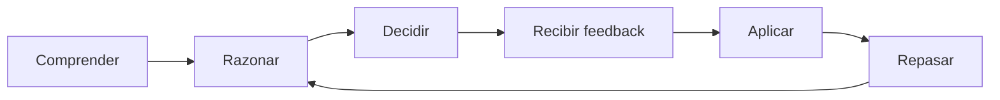

# Producto y aprendizaje

[← Volver al índice y análisis](README.md)

---

## 1. Visión general del producto

### 1.1. Objetivo

Construir una **plataforma educativa de ajedrez multiplataforma** que combine:

- Lecciones estructuradas desde los fundamentos hasta el juego avanzado.
- Estudio interactivo de partidas de grandes maestros.
- Ejercicios tácticos, estratégicos y de cálculo.
- Partidas contra una inteligencia artificial de ajedrez.
- Análisis de decisiones, errores y variantes.
- Un entrenador inteligente que explique _por qué_ una decisión es buena o mala.
- Seguimiento del progreso y recomendaciones de entrenamiento.

La propuesta no consiste en crear simplemente otro sitio para jugar ajedrez. Su diferenciador es funcionar como una **academia personal con entrenador inteligente**, donde cada partida, lección y ejercicio está conectado con el aprendizaje.

### 1.2. Problema que resuelve

Muchas herramientas permiten resolver tácticas o jugar partidas, pero el jugador puede terminar:

- Memorizando aperturas sin comprender los planes que las justifican.
- Consultando el mejor movimiento del motor sin entender la posición.
- Repitiendo errores que no se convierten en nuevos ejercicios.
- Acumulando partidas sin una ruta educativa clara.
- Midiendo su progreso solamente mediante victorias o puntos de rating.

Esta aplicación debe ayudar al estudiante a **observar, analizar, generar movimientos candidatos, calcular variantes, evaluar consecuencias y justificar una decisión**.

### 1.3. Seis pilares

| Pilar                      | Finalidad                                                                    |
| -------------------------- | ---------------------------------------------------------------------------- |
| **Academia**               | Enseñar conceptos mediante lecciones secuenciales e interactivas.            |
| **Grandes maestros**       | Comprender estilos, ideas estratégicas y decisiones históricas.              |
| **Entrenamiento**          | Consolidar conocimientos con ejercicios tácticos, posicionales y de cálculo. |
| **Arena contra IA**        | Practicar partidas completas o posiciones específicas contra un motor.       |
| **Entrenador inteligente** | Explicar alternativas, formular preguntas y recomendar práctica.             |
| **Progreso**               | Medir dominio, debilidades, revisiones y mejoras sostenidas.                 |

### 1.4. Principios de producto

1. **Aprendizaje antes que gamificación:** los puntos y logros no deben sustituir el dominio de habilidades.
2. **Razonamiento antes que respuesta:** no mostrar la mejor jugada hasta que el usuario haya intentado analizar.
3. **Explicaciones verificadas:** no permitir que un modelo generativo invente jugadas ilegales o variantes incorrectas.
4. **Repetición inteligente:** reintroducir conceptos que el estudiante aún no domina.
5. **Contenido curado:** priorizar ejercicios bien explicados sobre bibliotecas enormes sin contexto.
6. **Reutilización técnica:** un núcleo de ajedrez compartido debe funcionar en lecciones, ejercicios y partidas.

---

---

## 2. Estrategia multiplataforma

### 2.1. Propuesta

Empezar con **React + TypeScript + Vite**, construyendo una interfaz responsive e instalable como **Progressive Web App (PWA)**.

Después, reutilizar la mayor parte de la base de código para:

- **Android e iOS**, mediante Capacitor.
- **Windows, macOS y Linux**, mediante Tauri.

La aplicación debe compartir la lógica de las reglas, la representación de posiciones, los contratos de API, la biblioteca de componentes y las funcionalidades educativas.

### 2.2. Fases de distribución

| Fase | Plataforma            | Propósito                                           |
| ---- | --------------------- | --------------------------------------------------- |
| 1    | Web responsive        | Validar los módulos con una sola aplicación.        |
| 2    | PWA                   | Permitir instalación desde navegadores compatibles. |
| 3    | Android               | Ofrecer una experiencia móvil distribuible.         |
| 4    | iOS                   | Ampliar la distribución móvil.                      |
| 5    | Tauri para escritorio | Crear instaladores para Windows, macOS y Linux.     |

> **Decisión importante:** no crear aplicaciones nativas independientes desde el primer día. La prioridad es validar una experiencia educativa funcional y adaptable.

### 2.3. Consideraciones

- El tablero debe funcionar tanto con ratón como con interacción táctil.
- La interfaz tiene que conservar espacio suficiente para el tablero en pantallas pequeñas.
- Los motores WASM deben probarse en teléfonos de capacidad media; su consumo de CPU, memoria y batería puede variar.
- Las características offline pueden construirse progresivamente; una PWA no implica por sí sola que todas las lecciones o partidas funcionen sin conexión.
- Capacitor y Tauri requieren pruebas específicas de integración, distribución y permisos; compartir frontend no elimina el trabajo de empaquetado.

---

---

## 3. Metodología educativa

### 3.1. Principio central

**El objetivo es enseñar a pensar como un jugador de ajedrez, no enseñar a copiar las sugerencias de un motor.**

Cada unidad debe trabajar una habilidad y comprobar que el alumno puede aplicarla en posiciones diferentes de las utilizadas en la explicación.

### 3.2. Ciclo de aprendizaje

1. **Comprender:** presentar un concepto y una posición de ejemplo.
2. **Razonar:** pedir al usuario que observe amenazas, piezas y planes antes de recibir ayuda.
3. **Decidir:** seleccionar una jugada y, cuando corresponda, explicar el motivo.
4. **Recibir retroalimentación:** contrastar la elección con una solución verificada y explicar las alternativas.
5. **Aplicar:** practicar el mismo concepto jugando una posición o resolviendo un caso nuevo.
6. **Repasar:** volver al concepto en sesiones posteriores mediante repetición espaciada.



### 3.3. Preguntas que debe fomentar la aplicación

- ¿Qué amenaza mi rival?
- ¿Qué piezas están desprotegidas o mal coordinadas?
- ¿Qué movimientos candidatos tengo?
- ¿Hay jaques, capturas o amenazas forzadas?
- ¿Cuál es el plan a corto y largo plazo?
- ¿Qué respuesta crítica tiene el oponente?
- ¿Qué cambia en la evaluación de la posición después de mi jugada?
- ¿Por qué una alternativa aparentemente razonable funciona peor?

### 3.4. Estructura recomendada de una lección

Cada lección puede contener:

1. Introducción y objetivo medible.
2. Explicación breve del concepto.
3. Posición ilustrativa sobre el tablero.
4. Pregunta de predicción o análisis.
5. Interacción del usuario con las piezas.
6. Validación y explicación progresiva.
7. Un nuevo ejercicio de transferencia.
8. Mini-evaluación.
9. Registro de dominio y programación del siguiente repaso.

### 3.5. Ejemplo corregido: tenedor de caballo

**Objetivo:** reconocer un ataque doble al rey y a una torre.

**Posición FEN:**

```text
6k1/7r/8/8/4N3/8/8/4K3 w - - 0 1
```

- Blancas: rey en e1 y caballo en e4.
- Negras: rey en g8 y torre en h7.
- Juegan las blancas.

**Pregunta:** ¿qué jugada permite dar jaque y atacar la torre simultáneamente?

**Respuesta:** `1. Nf6+` (notación en español: `1. Cf6+`). El caballo se mueve de e4 a f6 y ataca al rey en g8 y a la torre en h7.

**Proceso educativo esperado:**

1. El usuario explora la posición antes de solicitar pistas.
2. Mueve el caballo en el tablero.
3. El sistema valida legalidad y solución.
4. Resalta las dos amenazas.
5. Explica por qué el jaque exige una respuesta.
6. Presenta otra posición con un patrón parecido, pero piezas y casillas diferentes.

> **Nota:** este ejemplo sustituye al ejemplo visual inicial que situaba un caballo en e5 y sugería erróneamente `Cf7+` como jaque al rey en g8. El ejercicio correcto es el de caballo e4–f6 indicado arriba. Todas las posiciones publicadas deben validarse con un motor de reglas.

### 3.6. Criterios pedagógicos

- Medir respuestas **sin pistas** por separado de respuestas con pistas.
- Registrar el número de intentos y la naturaleza del error.
- Introducir casos de transferencia, no solo variaciones memorizadas.
- Evitar que el estudiante pueda avanzar sin comprender el concepto esencial.
- Repetir conceptos con intervalos ajustados al desempeño.
- Permitir revisar por qué una respuesta anterior fue incorrecta.

---

---

## 4. Plan de estudios de ajedrez

La academia debe presentar una progresión clara, con prerrequisitos y evaluaciones que comprueben el dominio de cada habilidad.

| Nivel                    | Temas                                                                           | Resultado esperado                                            |
| ------------------------ | ------------------------------------------------------------------------------- | ------------------------------------------------------------- |
| **1. Fundamentos**       | Reglas, movimientos, jaque, mate, tablas, notación, valor de piezas.            | Jugar partidas legales y comprender el objetivo del juego.    |
| **2. Táctica**           | Clavadas, tenedores, ataques dobles, descubiertos, desviaciones, sacrificios.   | Reconocer patrones y calcular secuencias forzadas.            |
| **3. Aperturas**         | Desarrollo, centro, seguridad del rey, iniciativa y estructuras iniciales.      | Entender planes sin memorizar líneas ciegamente.              |
| **4. Medio juego**       | Casillas débiles, peones, columnas abiertas, coordinación, profilaxis y planes. | Evaluar posiciones y formular una estrategia.                 |
| **5. Finales**           | Rey y peones, oposición, triangulación, torres y finales fundamentales.         | Convertir ventajas y defender posiciones inferiores.          |
| **6. Cálculo avanzado**  | Movimientos candidatos, variantes, jugadas intermedias y evaluación.            | Razonar de manera estructurada en posiciones complejas.       |
| **7. Maestría práctica** | Partidas magistrales, preparación, defensa y análisis de errores.               | Aplicar el conocimiento de forma autónoma en partidas nuevas. |

### 4.1. Estructura académica

```text
Academia
└── Nivel
    └── Curso
        └── Unidad
            └── Lección
                ├── Explicación
                ├── Ejemplo interactivo
                ├── Pregunta guiada
                ├── Ejercicio
                └── Evaluación
```

### 4.2. Desbloqueo de contenidos

El avance no debe depender solamente de marcar lecciones como completadas. Una unidad se considerará dominada cuando el usuario sea capaz de:

- Resolver ejercicios nuevos del concepto estudiado.
- Explicar correctamente el motivo principal de una decisión.
- Repetir el rendimiento en revisiones posteriores.

Es preferible establecer umbrales configurables y perfeccionarlos con datos reales de usuarios, en lugar de asumir desde el inicio que un porcentaje fijo equivale a dominio definitivo.

---

---

## 5. Módulo de grandes maestros

### 5.1. Objetivo

Transformar partidas históricas en **lecciones interactivas sobre estilos, planes, errores y decisiones**.

No se busca únicamente reproducir un PGN. El alumno debe descubrir la idea estratégica de una partida y practicarla después en una posición similar.

### 5.2. Maestros y líneas temáticas iniciales

| Gran maestro             | Enfoque de enseñanza                                  | Tipo de ejercicios                                      |
| ------------------------ | ----------------------------------------------------- | ------------------------------------------------------- |
| **José Raúl Capablanca** | Técnica, juego sencillo y finales.                    | Conversión de ventajas, simplificación y coordinación.  |
| **Mijaíl Tal**           | Ataque, iniciativa, sacrificios y cálculo.            | Evaluación de sacrificios y variantes críticas.         |
| **Anatoli Kárpov**       | Juego posicional, restricción y profilaxis.           | Prevención de amenazas y explotación de debilidades.    |
| **Garry Kasparov**       | Dinamismo, iniciativa, coordinación y preparación.    | Creación de amenazas y cálculo táctico.                 |
| **Magnus Carlsen**       | Presión posicional, resistencia y técnica de finales. | Explotación de pequeñas ventajas y precisión defensiva. |

### 5.3. Modalidades de estudio de una partida

1. **Reproducción comentada:** visualizar el desarrollo y comprender los momentos críticos.
2. **Predicción de jugadas:** detener la reproducción y pedir al usuario que decida.
3. **Identificación de planes:** reconocer la idea estratégica de cada bando.
4. **Práctica contra el motor:** comenzar desde una posición histórica y continuar jugando.

### 5.4. Ejemplo de experiencia

Al estudiar un sacrificio de Tal:

1. La partida se detiene antes del momento crítico.
2. El usuario identifica las piezas activas, amenazas y posibles sacrificios.
3. Selecciona una jugada candidata y explica la compensación esperada.
4. El sistema muestra variantes verificadas.
5. Una explicación original presenta los principios que justifican o cuestionan el sacrificio.
6. El alumno practica el patrón en otra posición.

### 5.5. Política editorial

- Mantener las jugadas y datos de la partida separados de los comentarios educativos.
- Escribir comentarios propios o usar materiales con autorización.
- Conservar autoría, procedencia y licencia de cada recurso.
- No reproducir análisis protegidos de libros, cursos o sitios sin permiso.
- Verificar las posiciones, movimientos y soluciones antes de publicarlos.

---
