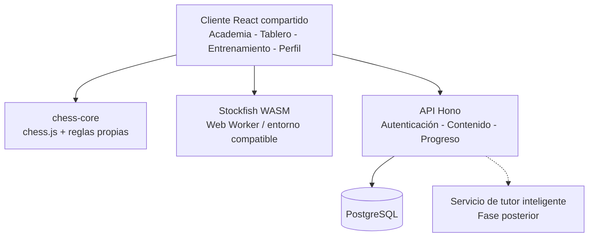

# Funcionalidades y arquitectura

[← Volver al índice y análisis](README.md)

---

## 6. Módulos funcionales

| Módulo                        | Funciones principales                                                                         | Prioridad     |
| ----------------------------- | --------------------------------------------------------------------------------------------- | ------------- |
| **Tablero interactivo**       | Movimientos, arrastrar piezas, selecciones táctiles, flechas, casillas destacadas, PGN y FEN. | MVP           |
| **Academia**                  | Cursos, lecciones, ejemplos, preguntas, pistas y evaluaciones.                                | MVP           |
| **Entrenamiento táctico**     | Ejercicios por temática, dificultad e intentos.                                               | MVP           |
| **Partidas contra IA**        | Color, nivel de dificultad, partidas completas, reloj opcional y posiciones iniciales.        | MVP           |
| **Análisis de partidas**      | Movimientos críticos, evaluación, variantes y alternativas.                                   | MVP básico    |
| **Grandes maestros**          | Biblioteca PGN, visor y preguntas interactivas.                                               | MVP           |
| **Progreso académico**        | Cursos completados, habilidades, revisiones y recomendaciones básicas.                        | MVP           |
| **Biblioteca personal**       | Partidas, posiciones y anotaciones guardadas.                                                 | Evolución     |
| **Entrenador conversacional** | Explicaciones dialogadas, preguntas y rutas adaptativas.                                      | Segunda etapa |

### 6.1. Dos modalidades contra IA

**Partida libre**

- Sin ayudas durante el juego.
- Configuración de color, dificultad y control de tiempo.
- Registro de movimientos y resultado.
- Análisis posterior opcional.

**Partida de entrenamiento**

- Permite pausar y estudiar posiciones.
- Ofrece pistas progresivas.
- Permite repetir posiciones críticas.
- Relaciona errores con conceptos y ejercicios.

### 6.2. Informe posterior a la partida

El reporte educativo debe responder:

1. **¿Dónde** se produjo el error o la oportunidad perdida?
2. **¿Por qué** fue una decisión inferior?
3. **¿Qué alternativa** existía y qué cambiaba en la posición?
4. **¿Qué concepto** debe estudiar el usuario para no repetirlo?

No basta con mostrar la evaluación del motor o una variación en centipeones; el sistema debe convertir ese dato en una explicación y una actividad educativa.

---

---

## 7. Stack tecnológico

El stack debe aprovechar la arquitectura TypeScript, Hono, React, Prisma, Better Auth y componentes encapsulados.

| Capa                       | Tecnología                      | Función                                                      |
| -------------------------- | ------------------------------- | ------------------------------------------------------------ |
| Frontend                   | React + TypeScript + Vite       | Interfaz compartida.                                         |
| UI                         | PrimeReact mediante wrappers    | Componentes visuales sin acoplar features a la biblioteca.   |
| Tablero                    | `react-chessboard`              | Renderizado e interacción con piezas.                        |
| Reglas de ajedrez          | `chess.js`                      | Movimientos legales, estado, FEN y PGN.                      |
| Motor de análisis          | Stockfish + WebAssembly         | Búsqueda de jugadas y evaluaciones.                          |
| Backend                    | Hono + TypeScript               | Servicios y API de negocio.                                  |
| Validación y documentación | Zod + OpenAPI                   | Contratos, esquemas y documentación.                         |
| Autenticación              | Better Auth                     | Usuarios y sesiones.                                         |
| Persistencia               | PostgreSQL + Prisma             | Datos de aprendizaje, partidas y contenido.                  |
| Consultas cliente          | TanStack Query                  | Estado remoto, caché y sincronización.                       |
| Monorepo                   | pnpm workspaces                 | Paquetes y aplicaciones compartidas.                         |
| Empaquetado móvil          | Capacitor                       | Android y iOS.                                               |
| Empaquetado escritorio     | Tauri                           | Windows, macOS y Linux.                                      |
| Pruebas                    | Vitest + Playwright             | Pruebas unitarias, integración y E2E.                        |
| Diseño de vistas           | Flujo de trabajo con Impeccable | Consistencia de diseño, accesibilidad y refinamiento visual. |

### 7.1. Separación de responsabilidades de IA

**Stockfish**

- Calcula variantes.
- Evalúa posiciones.
- Elige movimientos para el rival artificial.
- Utiliza el protocolo UCI para intercambiar comandos y resultados.

**Motor pedagógico**

- Determina los conceptos dominados.
- Detecta habilidades débiles.
- Organiza revisiones espaciadas.
- Recomienda la siguiente actividad.

**Tutor conversacional**

- Traduce análisis verificados a explicaciones comprensibles.
- Hace preguntas de reflexión.
- Compara planes y alternativas.
- Adapta el lenguaje al nivel del estudiante.

> No es necesario entrenar desde cero un modelo para jugar ajedrez. La primera versión puede utilizar Stockfish y reglas pedagógicas deterministas. El tutor generativo se incorpora después.

### 7.2. Dependencias técnicas fundamentales

- `chess.js` valida las reglas; `react-chessboard` solo representa e interactúa con el tablero.
- Stockfish analiza posiciones; no sustituye el motor de reglas.
- El dominio no depende directamente de Hono, Prisma, React ni PrimeReact.
- Las features del frontend utilizan componentes propios de `packages/ui` y no importan PrimeReact directamente.
- El frontend obtiene los contratos de API desde un paquete compartido o cliente tipado.
- Las respuestas generadas por IA no se consideran prueba suficiente de legalidad o corrección de una variante.

---

---

## 8. Arquitectura del sistema

### 8.1. Diagrama general



En el MVP, se prioriza la ejecución local de Stockfish cuando el dispositivo lo permita. El análisis de partidas intensivo o tareas de procesamiento masivo pueden migrarse posteriormente a workers o servicios del backend.

### 8.2. Estructura inicial del monorepositorio

```text
chess-academy/
├── apps/
│   ├── web/                # React + Vite + PWA
│   ├── api/                # Hono
│   ├── mobile/             # Capacitor (fase posterior)
│   └── desktop/            # Tauri (fase posterior)
│
├── packages/
│   ├── ui/                 # Wrappers de PrimeReact
│   ├── chess-core/         # Reglas, movimientos, notación
│   ├── chess-engine/       # Integración de Stockfish/UCI
│   ├── content-schema/     # Esquemas de lecciones y ejercicios
│   ├── api-client/         # Cliente tipado de API
│   └── shared/             # Tipos y utilidades compartidas
│
├── prisma/
│   └── schema.prisma
│
├── scripts/
│   └── import-content/
│
└── pnpm-workspace.yaml
```

> Los directorios `mobile` y `desktop` se preparan conceptualmente desde el inicio, pero no necesitan implementarse antes de validar la PWA.

### 8.3. Estructura propuesta del backend

```text
apps/api/src/
├── features/
│   ├── courses/
│   ├── lessons/
│   ├── exercises/
│   ├── master-games/
│   ├── training/
│   ├── matches/
│   ├── game-analysis/
│   ├── progress/
│   └── tutor/              # Segunda etapa
│
├── auth/
├── infrastructure/
└── app.ts
```

Cada feature puede incluir capas según su complejidad:

```text
features/exercises/
├── domain/
├── application/
├── infrastructure/
└── http/
```

### 8.4. Reglas de dependencia

1. `domain` define entidades, invariantes y reglas de negocio.
2. `application` orquesta casos de uso y depende del dominio.
3. `infrastructure` implementa repositorios, acceso a datos e integraciones.
4. `http` expone rutas, valida solicitudes y ejecuta casos de uso.
5. Un módulo no accede directamente a tablas internas de otro sin contratos establecidos.
6. Los adaptadores de persistencia deben poder sustituirse sin reescribir reglas educativas.
7. Los componentes visuales del tablero no implementan por sí mismos reglas de ajedrez.

---

---

## 9. Modelo de datos y API

### 9.1. Entidades principales

| Entidad            | Responsabilidad                                            |
| ------------------ | ---------------------------------------------------------- |
| `User`             | Identidad, preferencias y configuración.                   |
| `Course`           | Curso, objetivo, nivel y metadatos.                        |
| `Lesson`           | Lección, orden y prerrequisitos.                           |
| `LessonStep`       | Explicación, pregunta, actividad o posición interactiva.   |
| `ChessPosition`    | FEN y metadatos de una posición reutilizable.              |
| `Exercise`         | Posición, solución, temas y dificultad.                    |
| `MasterGame`       | PGN, jugadores, fecha, torneo y procedencia.               |
| `GameAnnotation`   | Comentarios propios, variantes y momentos críticos.        |
| `GameSession`      | Partida del usuario y su resultado.                        |
| `ExerciseAttempt`  | Respuesta, tiempo, número de intentos y pistas.            |
| `UserProgress`     | Avance y completitud por unidad o lección.                 |
| `SkillMastery`     | Estimación de dominio por habilidad.                       |
| `ReviewSchedule`   | Programación de repaso.                                    |
| `EngineEvaluation` | Evaluación previamente calculada con parámetros conocidos. |

### 9.2. Formatos estándar

- **FEN:** representa una posición concreta del tablero, turno y otros datos del estado.
- **PGN:** almacena movimientos de una partida y puede incluir encabezados, anotaciones y variantes.
- **UCI:** protocolo de comunicación con motores como Stockfish.

Se recomienda almacenar las partidas completas en PGN y las posiciones reutilizables en FEN, manteniendo identificadores y metadatos para relacionarlas con lecciones y ejercicios.

### 9.3. Endpoints iniciales

```http
GET  /api/courses
GET  /api/courses/:id
GET  /api/lessons/:id

GET  /api/exercises/next
POST /api/exercises/:id/attempts

GET  /api/master-games
GET  /api/master-games/:id

POST /api/matches
POST /api/matches/:id/moves
GET  /api/matches/:id/analysis

GET  /api/me/progress
GET  /api/me/reviews

POST /api/tutor/explain       # Segunda etapa
```

### 9.4. Reglas de integridad

- Validar legalidad antes de persistir movimientos de partidas que afecten al progreso.
- No confiar en calificaciones o resultados enviados únicamente por el cliente.
- Validar FEN y soluciones de ejercicios al importar contenidos.
- Distinguir una **jugada legal**, la **solución prevista** y una **jugada alternativa también válida**.
- Guardar versión del contenido para conservar el contexto de intentos antiguos.
- Mantener la fuente y la licencia del contenido importado.
- Almacenar profundidad y parámetros relevantes junto a evaluaciones de motor cuando se usen para análisis comparables.

---
