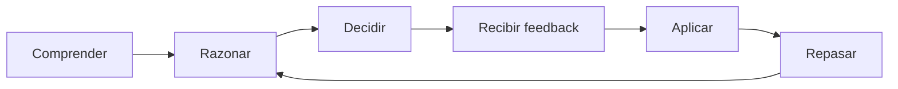
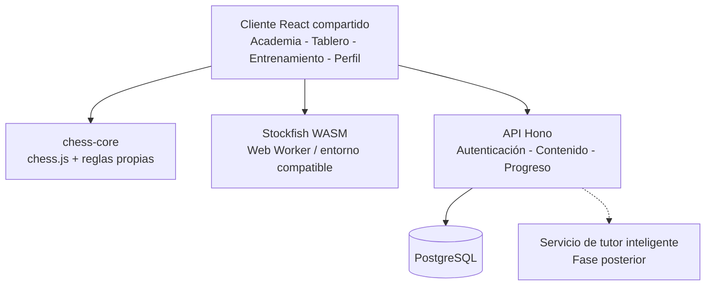

# Plan maestro: Academia de Ajedrez con Entrenador Inteligente

> **Tipo de proyecto:** plataforma educativa de ajedrez multiplataforma.  
> **Plataformas objetivo:** web, PWA, Android, iOS, Windows, macOS y Linux.  
> **Estrategia inicial:** una aplicación web responsive e instalable, seguida de empaquetados móviles y de escritorio.  
> **Duración estimada del MVP:** 20 semanas, dedicando aproximadamente 12–20 horas semanales.  
> **Estado:** propuesta de producto y hoja de ruta de implementación.  
> **Actualizado:** 29 de octubre de 2026.

---

## Índice

1. [Visión general del producto](#1-visión-general-del-producto)
2. [Estrategia multiplataforma](#2-estrategia-multiplataforma)
3. [Metodología educativa](#3-metodología-educativa)
4. [Plan de estudios de ajedrez](#4-plan-de-estudios-de-ajedrez)
5. [Módulo de grandes maestros](#5-módulo-de-grandes-maestros)
6. [Módulos funcionales](#6-módulos-funcionales)
7. [Stack tecnológico](#7-stack-tecnológico)
8. [Arquitectura del sistema](#8-arquitectura-del-sistema)
9. [Modelo de datos y API](#9-modelo-de-datos-y-api)
10. [Ruta completa de desarrollo](#10-ruta-completa-de-desarrollo)
11. [Segunda etapa: entrenador inteligente avanzado](#11-segunda-etapa-entrenador-inteligente-avanzado)
12. [Fuentes de contenido y licencias](#12-fuentes-de-contenido-y-licencias)
13. [Criterios de calidad y métricas](#13-criterios-de-calidad-y-métricas)
14. [Fuera del alcance inicial](#14-fuera-del-alcance-inicial)
15. [Primer sprint recomendado](#15-primer-sprint-recomendado)
16. [Prioridades y conclusión](#16-prioridades-y-conclusión)
17. [Referencias técnicas](#17-referencias-técnicas)

---

## 1. Visión general del producto

### 1.1. Objetivo

Construir una **plataforma educativa de ajedrez multiplataforma** que combine:

- Lecciones estructuradas desde los fundamentos hasta el juego avanzado.
- Estudio interactivo de partidas de grandes maestros.
- Ejercicios tácticos, estratégicos y de cálculo.
- Partidas contra una inteligencia artificial de ajedrez.
- Análisis de decisiones, errores y variantes.
- Un entrenador inteligente que explique _por qué_ una decisión es buena o mala.
- Seguimiento del progreso y recomendaciones de entrenamiento.

La propuesta no consiste en crear simplemente otro sitio para jugar ajedrez. Su diferenciador es funcionar como una **academia personal con entrenador inteligente**, donde cada partida, lección y ejercicio está conectado con el aprendizaje.

### 1.2. Problema que resuelve

Muchas herramientas permiten resolver tácticas o jugar partidas, pero el jugador puede terminar:

- Memorizando aperturas sin comprender los planes que las justifican.
- Consultando el mejor movimiento del motor sin entender la posición.
- Repitiendo errores que no se convierten en nuevos ejercicios.
- Acumulando partidas sin una ruta educativa clara.
- Midiendo su progreso solamente mediante victorias o puntos de rating.

Esta aplicación debe ayudar al estudiante a **observar, analizar, generar movimientos candidatos, calcular variantes, evaluar consecuencias y justificar una decisión**.

### 1.3. Seis pilares

| Pilar                      | Finalidad                                                                    |
| -------------------------- | ---------------------------------------------------------------------------- |
| **Academia**               | Enseñar conceptos mediante lecciones secuenciales e interactivas.            |
| **Grandes maestros**       | Comprender estilos, ideas estratégicas y decisiones históricas.              |
| **Entrenamiento**          | Consolidar conocimientos con ejercicios tácticos, posicionales y de cálculo. |
| **Arena contra IA**        | Practicar partidas completas o posiciones específicas contra un motor.       |
| **Entrenador inteligente** | Explicar alternativas, formular preguntas y recomendar práctica.             |
| **Progreso**               | Medir dominio, debilidades, revisiones y mejoras sostenidas.                 |

### 1.4. Principios de producto

1. **Aprendizaje antes que gamificación:** los puntos y logros no deben sustituir el dominio de habilidades.
2. **Razonamiento antes que respuesta:** no mostrar la mejor jugada hasta que el usuario haya intentado analizar.
3. **Explicaciones verificadas:** no permitir que un modelo generativo invente jugadas ilegales o variantes incorrectas.
4. **Repetición inteligente:** reintroducir conceptos que el estudiante aún no domina.
5. **Contenido curado:** priorizar ejercicios bien explicados sobre bibliotecas enormes sin contexto.
6. **Reutilización técnica:** un núcleo de ajedrez compartido debe funcionar en lecciones, ejercicios y partidas.

---

## 2. Estrategia multiplataforma

### 2.1. Propuesta

Empezar con **React + TypeScript + Vite**, construyendo una interfaz responsive e instalable como **Progressive Web App (PWA)**.

Después, reutilizar la mayor parte de la base de código para:

- **Android e iOS**, mediante Capacitor.
- **Windows, macOS y Linux**, mediante Tauri.

La aplicación debe compartir la lógica de las reglas, la representación de posiciones, los contratos de API, la biblioteca de componentes y las funcionalidades educativas.

### 2.2. Fases de distribución

| Fase | Plataforma            | Propósito                                           |
| ---- | --------------------- | --------------------------------------------------- |
| 1    | Web responsive        | Validar los módulos con una sola aplicación.        |
| 2    | PWA                   | Permitir instalación desde navegadores compatibles. |
| 3    | Android               | Ofrecer una experiencia móvil distribuible.         |
| 4    | iOS                   | Ampliar la distribución móvil.                      |
| 5    | Tauri para escritorio | Crear instaladores para Windows, macOS y Linux.     |

> **Decisión importante:** no crear aplicaciones nativas independientes desde el primer día. La prioridad es validar una experiencia educativa funcional y adaptable.

### 2.3. Consideraciones

- El tablero debe funcionar tanto con ratón como con interacción táctil.
- La interfaz tiene que conservar espacio suficiente para el tablero en pantallas pequeñas.
- Los motores WASM deben probarse en teléfonos de capacidad media; su consumo de CPU, memoria y batería puede variar.
- Las características offline pueden construirse progresivamente; una PWA no implica por sí sola que todas las lecciones o partidas funcionen sin conexión.
- Capacitor y Tauri requieren pruebas específicas de integración, distribución y permisos; compartir frontend no elimina el trabajo de empaquetado.

---

## 3. Metodología educativa

### 3.1. Principio central

**El objetivo es enseñar a pensar como un jugador de ajedrez, no enseñar a copiar las sugerencias de un motor.**

Cada unidad debe trabajar una habilidad y comprobar que el alumno puede aplicarla en posiciones diferentes de las utilizadas en la explicación.

### 3.2. Ciclo de aprendizaje

1. **Comprender:** presentar un concepto y una posición de ejemplo.
2. **Razonar:** pedir al usuario que observe amenazas, piezas y planes antes de recibir ayuda.
3. **Decidir:** seleccionar una jugada y, cuando corresponda, explicar el motivo.
4. **Recibir retroalimentación:** contrastar la elección con una solución verificada y explicar las alternativas.
5. **Aplicar:** practicar el mismo concepto jugando una posición o resolviendo un caso nuevo.
6. **Repasar:** volver al concepto en sesiones posteriores mediante repetición espaciada.



### 3.3. Preguntas que debe fomentar la aplicación

- ¿Qué amenaza mi rival?
- ¿Qué piezas están desprotegidas o mal coordinadas?
- ¿Qué movimientos candidatos tengo?
- ¿Hay jaques, capturas o amenazas forzadas?
- ¿Cuál es el plan a corto y largo plazo?
- ¿Qué respuesta crítica tiene el oponente?
- ¿Qué cambia en la evaluación de la posición después de mi jugada?
- ¿Por qué una alternativa aparentemente razonable funciona peor?

### 3.4. Estructura recomendada de una lección

Cada lección puede contener:

1. Introducción y objetivo medible.
2. Explicación breve del concepto.
3. Posición ilustrativa sobre el tablero.
4. Pregunta de predicción o análisis.
5. Interacción del usuario con las piezas.
6. Validación y explicación progresiva.
7. Un nuevo ejercicio de transferencia.
8. Mini-evaluación.
9. Registro de dominio y programación del siguiente repaso.

### 3.5. Ejemplo corregido: tenedor de caballo

**Objetivo:** reconocer un ataque doble al rey y a una torre.

**Posición FEN:**

```text
6k1/7r/8/8/4N3/8/8/4K3 w - - 0 1
```

- Blancas: rey en e1 y caballo en e4.
- Negras: rey en g8 y torre en h7.
- Juegan las blancas.

**Pregunta:** ¿qué jugada permite dar jaque y atacar la torre simultáneamente?

**Respuesta:** `1. Nf6+` (notación en español: `1. Cf6+`). El caballo se mueve de e4 a f6 y ataca al rey en g8 y a la torre en h7.

**Proceso educativo esperado:**

1. El usuario explora la posición antes de solicitar pistas.
2. Mueve el caballo en el tablero.
3. El sistema valida legalidad y solución.
4. Resalta las dos amenazas.
5. Explica por qué el jaque exige una respuesta.
6. Presenta otra posición con un patrón parecido, pero piezas y casillas diferentes.

> **Nota:** este ejemplo sustituye al ejemplo visual inicial que situaba un caballo en e5 y sugería erróneamente `Cf7+` como jaque al rey en g8. El ejercicio correcto es el de caballo e4–f6 indicado arriba. Todas las posiciones publicadas deben validarse con un motor de reglas.

### 3.6. Criterios pedagógicos

- Medir respuestas **sin pistas** por separado de respuestas con pistas.
- Registrar el número de intentos y la naturaleza del error.
- Introducir casos de transferencia, no solo variaciones memorizadas.
- Evitar que el estudiante pueda avanzar sin comprender el concepto esencial.
- Repetir conceptos con intervalos ajustados al desempeño.
- Permitir revisar por qué una respuesta anterior fue incorrecta.

---

## 4. Plan de estudios de ajedrez

La academia debe presentar una progresión clara, con prerrequisitos y evaluaciones que comprueben el dominio de cada habilidad.

| Nivel                    | Temas                                                                           | Resultado esperado                                            |
| ------------------------ | ------------------------------------------------------------------------------- | ------------------------------------------------------------- |
| **1. Fundamentos**       | Reglas, movimientos, jaque, mate, tablas, notación, valor de piezas.            | Jugar partidas legales y comprender el objetivo del juego.    |
| **2. Táctica**           | Clavadas, tenedores, ataques dobles, descubiertos, desviaciones, sacrificios.   | Reconocer patrones y calcular secuencias forzadas.            |
| **3. Aperturas**         | Desarrollo, centro, seguridad del rey, iniciativa y estructuras iniciales.      | Entender planes sin memorizar líneas ciegamente.              |
| **4. Medio juego**       | Casillas débiles, peones, columnas abiertas, coordinación, profilaxis y planes. | Evaluar posiciones y formular una estrategia.                 |
| **5. Finales**           | Rey y peones, oposición, triangulación, torres y finales fundamentales.         | Convertir ventajas y defender posiciones inferiores.          |
| **6. Cálculo avanzado**  | Movimientos candidatos, variantes, jugadas intermedias y evaluación.            | Razonar de manera estructurada en posiciones complejas.       |
| **7. Maestría práctica** | Partidas magistrales, preparación, defensa y análisis de errores.               | Aplicar el conocimiento de forma autónoma en partidas nuevas. |

### 4.1. Estructura académica

```text
Academia
└── Nivel
    └── Curso
        └── Unidad
            └── Lección
                ├── Explicación
                ├── Ejemplo interactivo
                ├── Pregunta guiada
                ├── Ejercicio
                └── Evaluación
```

### 4.2. Desbloqueo de contenidos

El avance no debe depender solamente de marcar lecciones como completadas. Una unidad se considerará dominada cuando el usuario sea capaz de:

- Resolver ejercicios nuevos del concepto estudiado.
- Explicar correctamente el motivo principal de una decisión.
- Repetir el rendimiento en revisiones posteriores.

Es preferible establecer umbrales configurables y perfeccionarlos con datos reales de usuarios, en lugar de asumir desde el inicio que un porcentaje fijo equivale a dominio definitivo.

---

## 5. Módulo de grandes maestros

### 5.1. Objetivo

Transformar partidas históricas en **lecciones interactivas sobre estilos, planes, errores y decisiones**.

No se busca únicamente reproducir un PGN. El alumno debe descubrir la idea estratégica de una partida y practicarla después en una posición similar.

### 5.2. Maestros y líneas temáticas iniciales

| Gran maestro             | Enfoque de enseñanza                                  | Tipo de ejercicios                                      |
| ------------------------ | ----------------------------------------------------- | ------------------------------------------------------- |
| **José Raúl Capablanca** | Técnica, juego sencillo y finales.                    | Conversión de ventajas, simplificación y coordinación.  |
| **Mijaíl Tal**           | Ataque, iniciativa, sacrificios y cálculo.            | Evaluación de sacrificios y variantes críticas.         |
| **Anatoli Kárpov**       | Juego posicional, restricción y profilaxis.           | Prevención de amenazas y explotación de debilidades.    |
| **Garry Kasparov**       | Dinamismo, iniciativa, coordinación y preparación.    | Creación de amenazas y cálculo táctico.                 |
| **Magnus Carlsen**       | Presión posicional, resistencia y técnica de finales. | Explotación de pequeñas ventajas y precisión defensiva. |

### 5.3. Modalidades de estudio de una partida

1. **Reproducción comentada:** visualizar el desarrollo y comprender los momentos críticos.
2. **Predicción de jugadas:** detener la reproducción y pedir al usuario que decida.
3. **Identificación de planes:** reconocer la idea estratégica de cada bando.
4. **Práctica contra el motor:** comenzar desde una posición histórica y continuar jugando.

### 5.4. Ejemplo de experiencia

Al estudiar un sacrificio de Tal:

1. La partida se detiene antes del momento crítico.
2. El usuario identifica las piezas activas, amenazas y posibles sacrificios.
3. Selecciona una jugada candidata y explica la compensación esperada.
4. El sistema muestra variantes verificadas.
5. Una explicación original presenta los principios que justifican o cuestionan el sacrificio.
6. El alumno practica el patrón en otra posición.

### 5.5. Política editorial

- Mantener las jugadas y datos de la partida separados de los comentarios educativos.
- Escribir comentarios propios o usar materiales con autorización.
- Conservar autoría, procedencia y licencia de cada recurso.
- No reproducir análisis protegidos de libros, cursos o sitios sin permiso.
- Verificar las posiciones, movimientos y soluciones antes de publicarlos.

---

## 6. Módulos funcionales

| Módulo                        | Funciones principales                                                                         | Prioridad     |
| ----------------------------- | --------------------------------------------------------------------------------------------- | ------------- |
| **Tablero interactivo**       | Movimientos, arrastrar piezas, selecciones táctiles, flechas, casillas destacadas, PGN y FEN. | MVP           |
| **Academia**                  | Cursos, lecciones, ejemplos, preguntas, pistas y evaluaciones.                                | MVP           |
| **Entrenamiento táctico**     | Ejercicios por temática, dificultad e intentos.                                               | MVP           |
| **Partidas contra IA**        | Color, nivel de dificultad, partidas completas, reloj opcional y posiciones iniciales.        | MVP           |
| **Análisis de partidas**      | Movimientos críticos, evaluación, variantes y alternativas.                                   | MVP básico    |
| **Grandes maestros**          | Biblioteca PGN, visor y preguntas interactivas.                                               | MVP           |
| **Progreso académico**        | Cursos completados, habilidades, revisiones y recomendaciones básicas.                        | MVP           |
| **Biblioteca personal**       | Partidas, posiciones y anotaciones guardadas.                                                 | Evolución     |
| **Entrenador conversacional** | Explicaciones dialogadas, preguntas y rutas adaptativas.                                      | Segunda etapa |

### 6.1. Dos modalidades contra IA

**Partida libre**

- Sin ayudas durante el juego.
- Configuración de color, dificultad y control de tiempo.
- Registro de movimientos y resultado.
- Análisis posterior opcional.

**Partida de entrenamiento**

- Permite pausar y estudiar posiciones.
- Ofrece pistas progresivas.
- Permite repetir posiciones críticas.
- Relaciona errores con conceptos y ejercicios.

### 6.2. Informe posterior a la partida

El reporte educativo debe responder:

1. **¿Dónde** se produjo el error o la oportunidad perdida?
2. **¿Por qué** fue una decisión inferior?
3. **¿Qué alternativa** existía y qué cambiaba en la posición?
4. **¿Qué concepto** debe estudiar el usuario para no repetirlo?

No basta con mostrar la evaluación del motor o una variación en centipeones; el sistema debe convertir ese dato en una explicación y una actividad educativa.

---

## 7. Stack tecnológico

El stack debe aprovechar la arquitectura TypeScript, Hono, React, Prisma, Better Auth y componentes encapsulados.

| Capa                       | Tecnología                      | Función                                                      |
| -------------------------- | ------------------------------- | ------------------------------------------------------------ |
| Frontend                   | React + TypeScript + Vite       | Interfaz compartida.                                         |
| UI                         | PrimeReact mediante wrappers    | Componentes visuales sin acoplar features a la biblioteca.   |
| Tablero                    | `react-chessboard`              | Renderizado e interacción con piezas.                        |
| Reglas de ajedrez          | `chess.js`                      | Movimientos legales, estado, FEN y PGN.                      |
| Motor de análisis          | Stockfish + WebAssembly         | Búsqueda de jugadas y evaluaciones.                          |
| Backend                    | Hono + TypeScript               | Servicios y API de negocio.                                  |
| Validación y documentación | Zod + OpenAPI                   | Contratos, esquemas y documentación.                         |
| Autenticación              | Better Auth                     | Usuarios y sesiones.                                         |
| Persistencia               | PostgreSQL + Prisma             | Datos de aprendizaje, partidas y contenido.                  |
| Consultas cliente          | TanStack Query                  | Estado remoto, caché y sincronización.                       |
| Monorepo                   | pnpm workspaces                 | Paquetes y aplicaciones compartidas.                         |
| Empaquetado móvil          | Capacitor                       | Android y iOS.                                               |
| Empaquetado escritorio     | Tauri                           | Windows, macOS y Linux.                                      |
| Pruebas                    | Vitest + Playwright             | Pruebas unitarias, integración y E2E.                        |
| Diseño de vistas           | Flujo de trabajo con Impeccable | Consistencia de diseño, accesibilidad y refinamiento visual. |

### 7.1. Separación de responsabilidades de IA

**Stockfish**

- Calcula variantes.
- Evalúa posiciones.
- Elige movimientos para el rival artificial.
- Utiliza el protocolo UCI para intercambiar comandos y resultados.

**Motor pedagógico**

- Determina los conceptos dominados.
- Detecta habilidades débiles.
- Organiza revisiones espaciadas.
- Recomienda la siguiente actividad.

**Tutor conversacional**

- Traduce análisis verificados a explicaciones comprensibles.
- Hace preguntas de reflexión.
- Compara planes y alternativas.
- Adapta el lenguaje al nivel del estudiante.

> No es necesario entrenar desde cero un modelo para jugar ajedrez. La primera versión puede utilizar Stockfish y reglas pedagógicas deterministas. El tutor generativo se incorpora después.

### 7.2. Dependencias técnicas fundamentales

- `chess.js` valida las reglas; `react-chessboard` solo representa e interactúa con el tablero.
- Stockfish analiza posiciones; no sustituye el motor de reglas.
- El dominio no depende directamente de Hono, Prisma, React ni PrimeReact.
- Las features del frontend utilizan componentes propios de `packages/ui` y no importan PrimeReact directamente.
- El frontend obtiene los contratos de API desde un paquete compartido o cliente tipado.
- Las respuestas generadas por IA no se consideran prueba suficiente de legalidad o corrección de una variante.

---

## 8. Arquitectura del sistema

### 8.1. Diagrama general



En el MVP, se prioriza la ejecución local de Stockfish cuando el dispositivo lo permita. El análisis de partidas intensivo o tareas de procesamiento masivo pueden migrarse posteriormente a workers o servicios del backend.

### 8.2. Estructura inicial del monorepositorio

```text
chess-academy/
├── apps/
│   ├── web/                # React + Vite + PWA
│   ├── api/                # Hono
│   ├── mobile/             # Capacitor (fase posterior)
│   └── desktop/            # Tauri (fase posterior)
│
├── packages/
│   ├── ui/                 # Wrappers de PrimeReact
│   ├── chess-core/         # Reglas, movimientos, notación
│   ├── chess-engine/       # Integración de Stockfish/UCI
│   ├── content-schema/     # Esquemas de lecciones y ejercicios
│   ├── api-client/         # Cliente tipado de API
│   └── shared/             # Tipos y utilidades compartidas
│
├── prisma/
│   └── schema.prisma
│
├── scripts/
│   └── import-content/
│
└── pnpm-workspace.yaml
```

> Los directorios `mobile` y `desktop` se preparan conceptualmente desde el inicio, pero no necesitan implementarse antes de validar la PWA.

### 8.3. Estructura propuesta del backend

```text
apps/api/src/
├── features/
│   ├── courses/
│   ├── lessons/
│   ├── exercises/
│   ├── master-games/
│   ├── training/
│   ├── matches/
│   ├── game-analysis/
│   ├── progress/
│   └── tutor/              # Segunda etapa
│
├── auth/
├── infrastructure/
└── app.ts
```

Cada feature puede incluir capas según su complejidad:

```text
features/exercises/
├── domain/
├── application/
├── infrastructure/
└── http/
```

### 8.4. Reglas de dependencia

1. `domain` define entidades, invariantes y reglas de negocio.
2. `application` orquesta casos de uso y depende del dominio.
3. `infrastructure` implementa repositorios, acceso a datos e integraciones.
4. `http` expone rutas, valida solicitudes y ejecuta casos de uso.
5. Un módulo no accede directamente a tablas internas de otro sin contratos establecidos.
6. Los adaptadores de persistencia deben poder sustituirse sin reescribir reglas educativas.
7. Los componentes visuales del tablero no implementan por sí mismos reglas de ajedrez.

---

## 9. Modelo de datos y API

### 9.1. Entidades principales

| Entidad            | Responsabilidad                                            |
| ------------------ | ---------------------------------------------------------- |
| `User`             | Identidad, preferencias y configuración.                   |
| `Course`           | Curso, objetivo, nivel y metadatos.                        |
| `Lesson`           | Lección, orden y prerrequisitos.                           |
| `LessonStep`       | Explicación, pregunta, actividad o posición interactiva.   |
| `ChessPosition`    | FEN y metadatos de una posición reutilizable.              |
| `Exercise`         | Posición, solución, temas y dificultad.                    |
| `MasterGame`       | PGN, jugadores, fecha, torneo y procedencia.               |
| `GameAnnotation`   | Comentarios propios, variantes y momentos críticos.        |
| `GameSession`      | Partida del usuario y su resultado.                        |
| `ExerciseAttempt`  | Respuesta, tiempo, número de intentos y pistas.            |
| `UserProgress`     | Avance y completitud por unidad o lección.                 |
| `SkillMastery`     | Estimación de dominio por habilidad.                       |
| `ReviewSchedule`   | Programación de repaso.                                    |
| `EngineEvaluation` | Evaluación previamente calculada con parámetros conocidos. |

### 9.2. Formatos estándar

- **FEN:** representa una posición concreta del tablero, turno y otros datos del estado.
- **PGN:** almacena movimientos de una partida y puede incluir encabezados, anotaciones y variantes.
- **UCI:** protocolo de comunicación con motores como Stockfish.

Se recomienda almacenar las partidas completas en PGN y las posiciones reutilizables en FEN, manteniendo identificadores y metadatos para relacionarlas con lecciones y ejercicios.

### 9.3. Endpoints iniciales

```http
GET  /api/courses
GET  /api/courses/:id
GET  /api/lessons/:id

GET  /api/exercises/next
POST /api/exercises/:id/attempts

GET  /api/master-games
GET  /api/master-games/:id

POST /api/matches
POST /api/matches/:id/moves
GET  /api/matches/:id/analysis

GET  /api/me/progress
GET  /api/me/reviews

POST /api/tutor/explain       # Segunda etapa
```

### 9.4. Reglas de integridad

- Validar legalidad antes de persistir movimientos de partidas que afecten al progreso.
- No confiar en calificaciones o resultados enviados únicamente por el cliente.
- Validar FEN y soluciones de ejercicios al importar contenidos.
- Distinguir una **jugada legal**, la **solución prevista** y una **jugada alternativa también válida**.
- Guardar versión del contenido para conservar el contexto de intentos antiguos.
- Mantener la fuente y la licencia del contenido importado.
- Almacenar profundidad y parámetros relevantes junto a evaluaciones de motor cuando se usen para análisis comparables.

---

## 10. Ruta completa de desarrollo

**Estimación:** 20 semanas con una dedicación aproximada de 12–20 horas semanales. El calendario es orientativo y puede alargarse por pruebas, producción de material educativo o distribución en tiendas.

### Fase 1 — Definición del producto y prototipo (semanas 1–2)

**Objetivo:** delimitar el MVP y diseñar la experiencia central de aprendizaje.

**Actividades**

- [ ] Definir el perfil del primer usuario objetivo.
- [ ] Formalizar requerimientos funcionales y no funcionales.
- [ ] Priorizar las funciones del MVP.
- [ ] Diseñar navegación responsive y estructura de pantallas.
- [ ] Prototipar tablero, lección, ejercicio y reporte de progreso.
- [ ] Definir criterios de éxito para el producto y la primera unidad educativa.

**Entregable:** prototipo navegable y backlog priorizado.

### Fase 2 — Fundamentos técnicos (semanas 3–4)

**Objetivo:** preparar una plataforma que permita agregar funciones sin rehacer la arquitectura.

**Actividades**

- [ ] Inicializar monorepo y workspaces.
- [ ] Configurar React, TypeScript y Vite.
- [ ] Configurar Hono y estructura modular de backend.
- [ ] Preparar PostgreSQL y Prisma.
- [ ] Implementar Better Auth e integración de sesiones en frontend.
- [ ] Crear el paquete `ui` con wrappers de componentes.
- [ ] Establecer linting, formateo, pruebas y convenciones de desarrollo.

**Entregable:** aplicación accesible con registro, inicio de sesión y navegación funcional.

### Fase 3 — Núcleo de ajedrez (semanas 5–6)

**Objetivo:** construir un tablero reutilizable, estable y correcto.

**Actividades**

- [ ] Integrar `chess.js` y `react-chessboard`.
- [ ] Validar movimientos legales y turnos.
- [ ] Implementar jaque, mate, ahogado, promociones, enroque y captura al paso.
- [ ] Importar y exportar FEN y PGN.
- [ ] Mostrar historial de movimientos.
- [ ] Agregar flechas, casillas destacadas y navegación de variantes.
- [ ] Probar interacciones con ratón y pantalla táctil.

**Entregable:** tablero funcional para PC y móvil, listo para reutilizarse en toda la aplicación.

### Fase 4 — Academia y lecciones (semanas 7–9)

**Objetivo:** publicar un primer curso interactivo.

**Actividades**

- [ ] Modelar cursos, unidades, lecciones y pasos.
- [ ] Crear reproductor de contenido educativo.
- [ ] Implementar preguntas de opción múltiple y ejercicios en tablero.
- [ ] Construir sistema de pistas y retroalimentación.
- [ ] Validar soluciones con el núcleo de reglas.
- [ ] Registrar completitud e intentos.
- [ ] Elaborar diez lecciones iniciales curadas.

**Entregable:** curso introductorio de 10 lecciones completas e interactivas.

### Fase 5 — Entrenamiento táctico (semanas 10–11)

**Objetivo:** establecer una biblioteca inicial de práctica deliberada.

**Actividades**

- [ ] Diseñar importador de ejercicios.
- [ ] Validar posiciones y soluciones.
- [ ] Clasificar por temática y dificultad.
- [ ] Registrar intentos, tiempo y pistas.
- [ ] Presentar ejercicios según dificultad inicial estimada.
- [ ] Incorporar filtros y estadísticas básicas.

**Entregable:** sistema de ejercicios con un conjunto inicial curado; meta de alcance de 300 ejercicios.

### Fase 6 — Partidas contra IA (semanas 12–14)

**Objetivo:** permitir práctica real contra un oponente artificial.

**Actividades**

- [ ] Integrar Stockfish en un worker cuando la plataforma lo soporte.
- [ ] Implementar comunicación UCI.
- [ ] Ofrecer niveles de dificultad y selección de color.
- [ ] Permitir partidas completas y posiciones iniciales específicas.
- [ ] Guardar partidas, movimientos y resultados.
- [ ] Implementar un análisis posterior básico.
- [ ] Probar rendimiento y consumo en dispositivos móviles.

**Entregable:** partidas completas contra motor y revisión inicial de errores.

### Fase 7 — Biblioteca de grandes maestros (semanas 15–16)

**Objetivo:** convertir partidas históricas en entrenamiento guiado.

**Actividades**

- [ ] Importar PGN seleccionados con metadatos.
- [ ] Construir catálogo y visor de partidas.
- [ ] Anotar posiciones críticas con comentarios originales.
- [ ] Implementar preguntas de predicción de jugadas.
- [ ] Permitir practicar desde una posición histórica.
- [ ] Documentar procedencia y licencias.

**Entregable:** diez partidas magistrales comentadas e interactivas.

### Fase 8 — Progreso y personalización (semanas 17–18)

**Objetivo:** conectar las actividades con un plan de mejora individual.

**Actividades**

- [ ] Implementar panel de progreso.
- [ ] Calcular dominio inicial por habilidad.
- [ ] Recomendar ejercicios a partir de errores.
- [ ] Programar revisiones espaciadas.
- [ ] Mostrar fortalezas y debilidades sin presentar resultados engañosos.
- [ ] Añadir pruebas de persistencia y consistencia.

**Entregable:** perfil educativo y plan básico de estudio personalizado.

### Fase 9 — Calidad y publicación del MVP (semanas 19–20)

**Objetivo:** lanzar la primera versión usable de principio a fin.

**Actividades**

- [ ] Ejecutar pruebas unitarias, integración y E2E.
- [ ] Verificar movimientos especiales y posiciones límite.
- [ ] Probar experiencia responsive y accesibilidad.
- [ ] Revisar autenticación, autorizaciones y seguridad de API.
- [ ] Optimizar recursos, cargas y memoria.
- [ ] Preparar despliegue web, HTTPS y PWA.
- [ ] Crear un proceso para recopilar feedback y errores reales de usuarios.

**Entregable:** MVP publicado, instalable donde el navegador lo permita y funcional en computadoras y teléfonos.

### 10.1. Resumen de hitos

| Fase               | Semanas | Resultado                                 |
| ------------------ | ------- | ----------------------------------------- |
| 1. Producto        | 1–2     | Prototipo y alcance validable.            |
| 2. Infraestructura | 3–4     | Aplicación con autenticación.             |
| 3. Ajedrez         | 5–6     | Tablero legal y reutilizable.             |
| 4. Academia        | 7–9     | Diez lecciones iniciales.                 |
| 5. Táctica         | 10–11   | Entrenamiento y biblioteca de ejercicios. |
| 6. IA de juego     | 12–14   | Partidas contra Stockfish.                |
| 7. Maestros        | 15–16   | Diez partidas comentadas.                 |
| 8. Progreso        | 17–18   | Perfil y repaso adaptativo básico.        |
| 9. Lanzamiento     | 19–20   | PWA pública y probada.                    |

### 10.2. Metas de contenido para el MVP

- **10** lecciones interactivas iniciales.
- **300** ejercicios seleccionados y validados (meta).
- **10** partidas magistrales comentadas.
- **1** experiencia de juego contra Stockfish.
- **1** panel básico de progreso y revisiones.

Estas cifras son **objetivos de alcance**, no recursos ya creados ni plazos garantizados.

---

## 11. Segunda etapa: entrenador inteligente avanzado

Estas capacidades se incorporan después de verificar que el MVP educativo funciona correctamente.

### 11.1. Tutor conversacional

Permitir al usuario preguntar, por ejemplo:

- ¿Por qué mi sacrificio no funcionó?
- ¿Qué plan tenía mi rival?
- ¿Por qué Stockfish prefiere esta jugada?
- ¿Cómo puedo identificar este patrón en otras partidas?

**Contexto mínimo recomendado para el tutor:**

1. Posición FEN y último movimiento.
2. Variantes verificadas por Stockfish.
3. Objetivo de la lección y conceptos etiquetados.
4. Historial educativo pertinente del usuario.
5. Límites de la explicación: distinguir hechos calculados, criterios posicionales y estimaciones.

### 11.2. Análisis pedagógico automático

Después de una partida, el sistema podrá:

- Detectar omisión de amenazas.
- Identificar errores de cálculo.
- Detectar problemas recurrentes de apertura o desarrollo.
- Reconocer fallos en finales.
- Crear una lista de posiciones para revisar.
- Recomendar ejercicios relacionados con esos errores.

El análisis debe evitar clasificar automáticamente todos los errores como fallos de comprensión: una jugada inferior puede deberse a tiempo, complejidad táctica o simple descuido.

### 11.3. Entrenamiento adaptativo

- Ajustar dificultad de ejercicios.
- Repetir conceptos según desempeño.
- Recomendar lecciones por prerrequisitos no dominados.
- Proponer sesiones mixtas de táctica, estrategia, cálculo y finales.
- Revisar periódicamente si el aprendizaje se transfiere a partidas nuevas.

---

## 12. Fuentes de contenido y licencias

### 12.1. Bases de datos útiles

**Lichess Open Database:** <https://database.lichess.org/>

Puede utilizarse para investigar fuentes de partidas, posiciones, evaluaciones y ejercicios. Es conveniente importar inicialmente una selección pequeña y curada, en lugar de integrar millones de registros sin validación pedagógica.

**Recomendaciones de importación:**

1. Identificar la fuente y su licencia específica.
2. Importar PGN y metadatos.
3. Validar formato y legalidad.
4. Extraer posiciones críticas.
5. Calcular o contrastar soluciones.
6. Etiquetar tema, dificultad y objetivos.
7. Redactar explicación pedagógica original.
8. Revisar manualmente antes de publicar.

### 12.2. Consideraciones legales

- Las exportaciones generales de partidas de Lichess pueden tener condiciones distintas de sus conjuntos de retransmisiones; comprobar la licencia del **dataset concreto**.
- Los movimientos de una partida y sus metadatos no habilitan automáticamente copiar análisis, diagramas comentados o textos de terceros.
- Mantener atribuciones y obligaciones de redistribución cuando corresponda.
- Stockfish se distribuye bajo **GPLv3**; revisar sus obligaciones al distribuirlo dentro de una aplicación o instalador.
- Las licencias de imágenes, retratos y material audiovisual deben revisarse por separado.

> Esta sección sirve como checklist técnico-editorial; antes de redistribuir software o contenido debe revisarse la licencia aplicable a cada versión y recurso concreto.

---

## 13. Criterios de calidad y métricas

### 13.1. Calidad técnica

**Correctitud ajedrecística**

- [ ] Movimientos legales y rechazo de movimientos ilegales.
- [ ] Jaque, mate, ahogado y tablas.
- [ ] Enroque y derechos de enroque.
- [ ] Promoción y captura al paso.
- [ ] Importación y exportación de PGN.
- [ ] Lectura y escritura de FEN.
- [ ] Correspondencia entre la posición y el historial de jugadas.
- [ ] Verificación de soluciones y variantes de ejercicios.

**Experiencia de uso**

- [ ] Tablero cómodo con ratón y táctil.
- [ ] Diseño responsive en móviles de gama media.
- [ ] Navegación por teclado donde sea apropiado.
- [ ] Etiquetas y contraste accesibles.
- [ ] Estados de carga, error y reconexión claros.
- [ ] Rendimiento aceptable al utilizar el motor.

**Seguridad e integridad**

- [ ] Sesiones autenticadas correctamente.
- [ ] Autorización para consultar o modificar progreso propio.
- [ ] Validación de entrada en la API.
- [ ] Verificación de resultados educativos en servidor cuando corresponda.
- [ ] Protección contra abuso de endpoints costosos.
- [ ] Registro seguro de errores sin exponer información sensible.

### 13.2. Métricas educativas

Medir al menos:

| Indicador                             | Qué demuestra                              |
| ------------------------------------- | ------------------------------------------ |
| Resolución correcta al primer intento | Desempeño sin ayuda.                       |
| Porcentaje de respuestas con pistas   | Dependencia de asistencia.                 |
| Retención a 7 y 30 días               | Permanencia del aprendizaje.               |
| Rendimiento por tema                  | Fortalezas y debilidades.                  |
| Errores repetidos                     | Conceptos aún no consolidados.             |
| Transferencia a posiciones nuevas     | Capacidad de generalización.               |
| Mejora en partidas de práctica        | Aplicación del conocimiento en juego real. |

**Precaución:** completar lecciones o ganar a un motor con dificultad reducida no equivale automáticamente a un rating ELO concreto. Una medición de fuerza ajedrecística requiere un procedimiento adecuado y datos suficientes.

### 13.3. Definición de MVP exitoso

El MVP se considera funcional cuando una persona puede:

1. Crear una cuenta.
2. Abrir una lección y comprender un concepto.
3. Resolver un ejercicio moviendo piezas sobre un tablero legal.
4. Recibir feedback sobre su respuesta.
5. Jugar contra el motor.
6. Revisar al menos un error de su partida.
7. Estudiar una partida magistral interactiva.
8. Consultar su progreso y una revisión pendiente.
9. Realizar el flujo desde una computadora o un teléfono.

---

## 14. Fuera del alcance inicial

No incluir en el MVP:

- Torneos multijugador.
- Partidas online entre usuarios en tiempo real.
- Ranking competitivo y matchmaking.
- Chats comunitarios.
- Entrenadores con avatares animados.
- Entrenamiento de un modelo de IA desde cero.
- Un catálogo masivo de miles de cursos sin revisión.
- Todas las funciones offline desde el primer lanzamiento.

Son posibilidades futuras, pero no son necesarias para demostrar que la plataforma puede enseñar ajedrez eficazmente.

---

## 15. Primer sprint recomendado

### Objetivo: una lección de extremo a extremo

Construir una **vertical slice** que conecte frontend, lógica de ajedrez, API y persistencia.

**Historia de usuario:**

> Como estudiante quiero abrir una lección, estudiar una posición, realizar una jugada legal, recibir una explicación y guardar mi progreso para continuar después.

### 15.1. Alcance técnico

- [ ] Mostrar tablero con una posición FEN definida.
- [ ] Permitir movimientos mediante ratón y táctil.
- [ ] Validar el movimiento con `chess.js`.
- [ ] Comparar la respuesta con una solución configurada.
- [ ] Mostrar retroalimentación y una pista opcional.
- [ ] Guardar el intento en el backend.
- [ ] Actualizar el progreso del usuario.
- [ ] Mostrar el resultado después de recargar la página.

### 15.2. Resultado esperado

Una única lección funcionando de principio a fin, utilizando el mismo componente de tablero que más adelante se empleará para:

- Academia.
- Táctica.
- Partidas magistrales.
- Arena contra IA.
- Análisis posterior.

El éxito de este sprint confirma la estructura técnica sobre la que se ampliará el resto del producto.

---

## 16. Prioridades y conclusión

### Orden de prioridades

1. **Correctitud del ajedrez:** reglas y estados confiables.
2. **Experiencia educativa:** lecciones y ejercicios que requieren razonamiento.
3. **Persistencia y progreso:** reconocer lo que el usuario domina y lo que debe repasar.
4. **Entrenamiento contra motor:** práctica auténtica y análisis básico.
5. **Partidas de maestros:** contenido curado de alta calidad.
6. **Personalización avanzada:** tutor conversacional y análisis pedagógico más sofisticado.
7. **Expansión de distribución:** móviles nativos, escritorio y capacidades offline adicionales.

### Resultado que se busca construir

Una plataforma en la que el estudiante no solo conozca la mejor jugada, sino que mejore su capacidad para:

- Interpretar posiciones.
- Reconocer patrones.
- Calcular variantes.
- Elaborar planes.
- Anticipar las respuestas del rival.
- Comprender sus errores.
- Transferir conocimientos a partidas reales.

**Idea rectora:** la ventaja competitiva no será tener más funciones que otras aplicaciones de ajedrez; será **convertir cada decisión del jugador en una oportunidad de aprendizaje verificable**.

---

## 17. Referencias técnicas

Referencias oficiales o repositorios de interés para la implementación (conviene revisar las versiones y licencias efectivas al iniciar el desarrollo):

- [Lichess Open Database](https://database.lichess.org/)
- [Stockfish — repositorio oficial](https://github.com/official-stockfish/Stockfish)
- [Protocolo UCI (Stockfish)](https://official-stockfish.github.io/docs/stockfish-wiki/UCI-&-Commands.html)
- [chess.js](https://github.com/jhlywa/chess.js)
- [react-chessboard](https://github.com/Clariity/react-chessboard)
- [Hono](https://hono.dev/)
- [Better Auth](https://www.better-auth.com/)
- [Prisma](https://www.prisma.io/)
- [PrimeReact](https://primereact.org/)
- [Capacitor](https://capacitorjs.com/)
- [Tauri](https://tauri.app/)
- [TanStack Query](https://tanstack.com/query/latest)
- [Playwright](https://playwright.dev/)

---

**Documento de planificación.** La ruta y los entregables pueden ajustarse según resultados del primer sprint, disponibilidad de contenido educativo y retroalimentación de usuarios.
